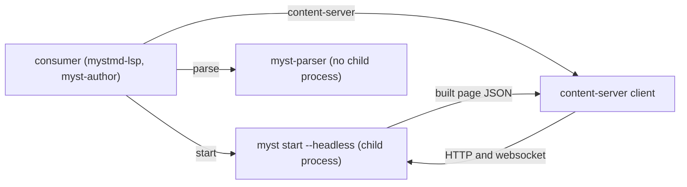

# mystmd-client

This package starts mystmd with `myst start --headless` and reads the pages from its content server.
It also parses MyST with mystmd's own settings.
It holds code that [mystmd-lsp](https://github.com/choldgraf/mystmd-lsp) and [myst-author](https://github.com/choldgraf/myst-author) both need, so they don't each keep a copy in sync by hand.
It is installed from GitHub rather than npm because it's temporary.
It can be deleted once mystmd [exports these helpers](#what-it-needs-upstream).

## Use

```
npm install mystmd-client@github:choldgraf/mystmd-client
```

npm builds it on install with the `prepare` script.
To move a project that uses it to a newer commit, run the same command or `npm update mystmd-client`, then commit its lock file.

```ts
import { parse, parseMyst, directives, roles } from 'mystmd-client/parse';
import { startMyst } from 'mystmd-client/start';
import { contentServer, mystmdMissing, type BuiltPage, type TocEntry } from 'mystmd-client/content-server';

const { tree, frontmatter, messages } = parseMyst(text, { keepTitle: true });

const myst = await startMyst(root, log, ['--execute']); // root holds myst.yml. log and args are optional.
// myst: { url, ready, exited, stop }

const server = contentServer(myst.url);
const pages: BuiltPage[] = await server.pages();
const toc: TocEntry[] = await server.toc();
const stopWatching = server.watch(onReload);
```

## How it works



Use `parse` to parse one page with mystmd's settings and extensions when you can't wait for a build.
Use `start` and `content-server` when you need mystmd's full build of a page, including plugins and cross-references.
Run the `myst` CLI yourself when you need a full export or site build.

## Develop

`npm test` runs without mystmd.
`npm run test:mystmd` also starts the real `mystmd` devDependency and checks its content server.
CI runs both, plus `npm run typecheck`.
The [docs site](https://chrisholdgraf.com/mystmd-client/) is this README.
`npm run docs:live` previews it and `npm run docs` builds it.

`myst-parser` is pinned to an exact version in `package.json`.
When you bump `mystmd`, check that it still uses that `myst-parser` version.
Otherwise `parseMyst` may stop matching `myst build`.
The published `mystmd` package doesn't list that version.
Find it in `packages/myst-cli/package.json` at the matching [mystmd tag](https://github.com/jupyter-book/mystmd/tags).
Consumers pin a commit of this package in their lock file.
Their `myst-common` range should match ours, so both use the same tree types.

## Interface

### `parse`

- `parseMyst` runs mystmd's single-page transforms with the extensions mystmd enables by default.
- `directives` and `roles` list what `parseMyst` parses.
- `keepTitle: true` keeps a leading `# Title`, which mystmd removes.
- `frontmatter` is what mystmd's frontmatter transform returns, including `title` and `content_includes_title`.
- `messages` are the parse and transform messages.
- Directive transforms leave a directive's children without a position, so they get the directive's position.

### `start`

- `startMyst` runs `myst` from `PATH`, or the binary named in `MYST_BIN`.
- It picks the port and serves at `http://127.0.0.1:<port>`.
  Without that, `myst start` [binds only IPv6 `localhost`](https://github.com/jupyter-book/mystmd/issues/2254).
- Nothing handles a conflict if another process takes that port before mystmd binds it.
- `log` receives each line of mystmd's stdout and stderr, prefixed with `[myst] `.
  It defaults to `console.log`.
- `ready` resolves when mystmd logs "Content server started".
  It rejects if mystmd exits before then.
  If mystmd isn't installed, it rejects with `mystmdMissing`.
- `exited` rejects if mystmd dies or isn't installed.
  Calling `stop` makes it reject too.
  Nothing restarts mystmd.

### `content-server`

- `BuiltPage` is the page JSON that the content server serves at `/content/<slug>.json`.
  Consumers read its `location`, `mdast`, `sha256`, `frontmatter` and `references`.
- `pages()` reads each page's JSON from the content server, the index page first.
- `pages()` reads only the first project in `config.json`.
- `toc()` is the first project's table of contents, the index page first.
  Each entry is `{ title, level, file? }`.
  Parts and external links have no `file`.
- `watch` calls back on every rebuild, and whenever its websocket connects or reconnects.
  It returns a function that stops it.
- A failed content server request throws an error whose message is the response body.

The rest is for myst-author alone:

- The content server's other methods, `built` and `fileForSlug`, and its `assets` argument.
- The exports `rebaseFetched`, `sha256` and `savedHashes`.
- The types `Built`, `ContentServer` and `Myst`.

## What it needs upstream

This package can be deleted once mystmd exports its own single-page parse, `myst start --headless` launcher and content-server client.
myst-author's [upstream list](https://github.com/choldgraf/myst-author/blob/main/upstream/README.md) asks for those exports.
